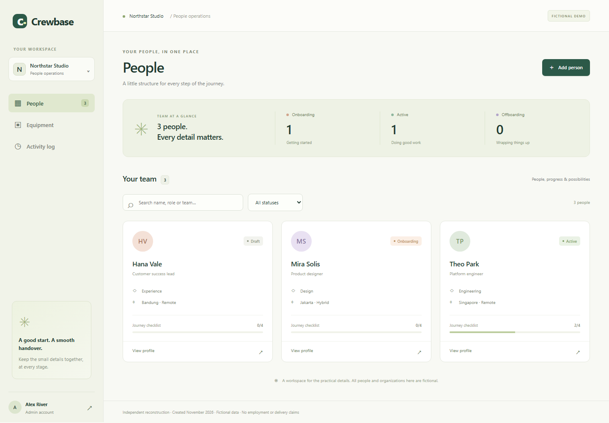

# Crewbase

**Independent people-operations reconstruction, created in November 2026.** Crewbase uses Laravel 13, Livewire 4 and SQLite to help a fictional team coordinate worker onboarding, handovers and equipment.

**This is newly written demonstration code, not employer source code or evidence of historical project participation. All people, organizations, equipment and credentials are synthetic. Commits use their actual creation dates.**



Follow the [complete worker-lifecycle walkthrough](docs/walkthrough.md) to try task requirements, equipment returns and stale-tab protection. For a related recruiting workflow, see [Teamline](https://github.com/hi676sweet/applicant-tracking-reconstruction).

## What it does

- Organization-scoped directory with live name, role and team search and lifecycle filters.
- Create a draft worker with required onboarding and offboarding checklists.
- A controlled lifecycle: `draft → onboarding → active → offboarding → closed`.
- Activation requires all onboarding tasks; closure requires all offboarding tasks and equipment returns.
- Equipment allocation with one owner per item and conditional database writes to reject competing assignments across different workers.
- Versioned writes reject stale tabs. Worker changes, equipment allocations and activity events commit in one transaction; failures roll all of them back.
- Administrator writes and viewer reads, with server-side authorization and organization isolation.
- Activity records protected from update/deletion by SQLite triggers. A database administrator who controls the file can still change the database schema; this is an application audit trail, not a tamper-proof evidence service.
- Original CSS, inline UI symbols and local SVG favicon. The interface uses locally installed system fonts and makes no font/CDN or email-service requests.

## Research and provenance

The supplied resume lists a Glints role from **January 2022 to July 2023**. Glints' own [August 30, 2022 funding announcement](https://glints.com/sg/inside/glints-raises-usd50m-funding/) names Managed Talent. Its [April 4, 2023 Southeast Asia startup talent report article](https://talenthub.glints.com/en-sg/blog/the-southeast-asia-startup-talent-report-2023) discusses technology-enabled talent acquisition, employer-of-record and talent development services. Those public descriptions support a talent-operations domain as an inspiration for a portfolio demonstration.

They do **not** establish this individual's assignment to TalentHub/Managed Talent, the exact software they built, a project delivery date or proprietary implementation details. Crewbase's lifecycle, task templates, equipment feature, brand and UI are our original demonstration choices. Present-day company offerings are not treated as proof of features built during 2022–2023. The resume's Glints entry lists React, Node.js and TypeScript; **Laravel here is a current reconstruction choice drawn from broader resume skills, not a claim about Glints' stack**.

No employer assets, confidential code or real employee records are included. This demo provides no payroll, tax or employment-eligibility calculations.

## Run locally

Requires PHP **8.4.1+** (8.5 recommended), Composer 2, and PHP extensions `pdo_sqlite`, `sqlite3`, `mbstring`, `openssl`, `fileinfo`, `tokenizer`, `xml` and `ctype`. No Node build, external database or hosted service is required.

```sh
composer install --no-interaction --prefer-dist
cp .env.example .env
php artisan key:generate
php -r "file_exists('database/database.sqlite') || touch('database/database.sqlite');"
php artisan migrate --seed --force
php artisan serve --host=127.0.0.1 --port=8067
```

On PowerShell, use `Copy-Item .env.example .env` instead of `cp` if preferred. Open http://127.0.0.1:8067. `composer setup` performs dependency installation, environment creation, key generation and seeding for a fresh installation. Do not run it repeatedly against an already seeded database; the demo seeder intentionally creates fixed fixtures.

| Demo account | Password | Access |
| --- | --- | --- |
| `admin@crewbase.test` | `DemoPass!2026` | Northstar administrator |
| `viewer@crewbase.test` | `DemoPass!2026` | Northstar viewer |
| `other@crewbase.test` | `DemoPass!2026` | Separate Seabrook organization |

Seeded workers: Mira Solis is onboarding, Theo Park is active and owns monitor `CB-102`, Hana Vale is draft. `CB-101` and `CB-103` are available. The other organization's worker/equipment are inaccessible from Northstar. All event timestamps are generated at seed or action time in UTC, not backdated to the resume period.

To intentionally reset **only your local demo data**, run `php artisan migrate:fresh --seed` (destroys this app's configured database). Keep `.env`, SQLite files, generated caches and dependencies out of Git.

## Verify

```sh
composer validate --strict
vendor/bin/pint --test --cache-file=/tmp/crewbase-fresh-pint.cache
php artisan test
php artisan view:cache
```

On Windows invoke Pint with `php vendor/laravel/pint/builds/pint --test --cache-file=storage/crewbase-fresh-pint.cache`. Use a new cache path for independent verification. Tests cover lifecycle gates, stale edits, competing allocation, transaction rollback on audit failure, task phase/repeat protection, cross-organization reads/writes, viewer write denial, escaped output, login/logout and live directory filters. CI also seeds a fresh SQLite database and compiles Blade templates from the published source.

## Boundaries

This is a single-process local demonstration, not a production HR system. SQLite uses foreign keys, a 5-second busy timeout and immediate transactions to serialize writes. Conditional asset allocation and worker versions remain the final write gates. No paid services, document uploads, background jobs, notifications, payroll or legal workflows are implemented. There are no custom task templates, destructive actions or reopening of closed records. Equipment is seeded; inventory procurement is outside this demo.

The seeded credentials are intentionally public and intended for local review.

## Attribution

MIT licensed. Laravel framework/bootstrap/configuration and project structure derive from the MIT Laravel skeleton by Taylor Otwell and the Teamline portfolio skeleton. Notices are retained in `LICENSE`. Crewbase domain code, data and interface are original reconstruction work. Built with assistance from ChatGPT/Codex; the repository's tests and documentation make its actual behavior reviewable.
