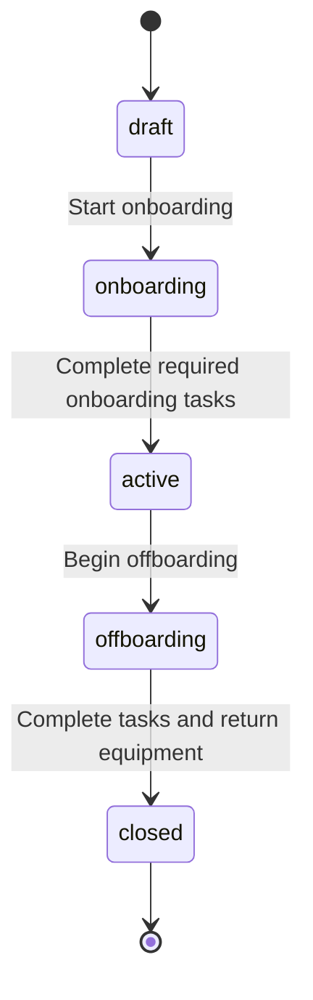

# Try the worker lifecycle

This walkthrough describes Crewbase's original demonstration workflows. The company-product research and resume context are documented separately in the README.

## A complete example

1. Run the setup commands in the README and sign in with the fictional administrator account.
2. Open `/workers/new`. Create a fictional worker with a name, job title, team and location. The record starts in **Draft**.
3. Select **Start onboarding**. Try **Activate worker** before completing the checklist: the server rejects the transition.
4. Complete **Verify profile** and **Arrange orientation**, then activate the worker. The lifecycle change and activity entry persist together.
5. Select an item from **Available equipment** and assign it. The equipment inventory now shows its owner; another worker cannot allocate the same item.
6. Begin offboarding. Complete **Hand over work** and **Revoke workspace access**. Closing is still blocked while equipment remains assigned.
7. Return the equipment, then close the worker. The item becomes available again and the lifecycle remains in its final state.

## Review stale tabs and access

Open an onboarding worker in two tabs. Complete a checklist task in the first tab, then submit a change from the older second tab. The second change is rejected until the record is refreshed. A stale submission must not silently overwrite a teammate's change or create an extra activity entry.

The viewer account can inspect its organization's directory, records and equipment but cannot mutate them. Other organizations' worker IDs remain inaccessible even when a URL is known. The automated tests exercise both reads and writes at these boundaries.

## What to inspect in the code

- `app/Services/PeopleOperations.php`: lifecycle gates, version comparisons, conditional equipment assignment and transactional activity records.
- Database migrations: relationships, uniqueness constraints and append-only activity guards.
- Feature tests: rejected transitions, competing allocation, organization boundaries and rollback when a required write fails.

Equipment assignment, task completion, lifecycle changes and their activity events commit together. A failed operation leaves the worker version, asset ownership and activity history consistent.

Crewbase demonstrates people operations with fictional data. It does not calculate payroll, decide employment eligibility or provide legal compliance services.
